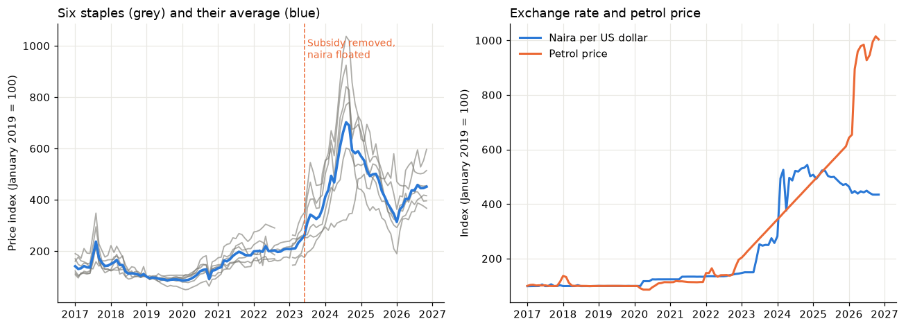

# Food price outlook for northeast Nigeria

Staple food prices in Borno and Yobe: the 2023 to 2024 price shock, an honest test of machine learning against simple forecasts, and a cash transfer planner.

**[Open the Streamlit app](https://nigeria-food-price-forecast-yhmk2lutumrsxbj2bzjztr.streamlit.app/)** · **[Open the web dashboard](https://chiamaka-uchenna.github.io/nigeria-food-price-forecast/)** · **[Read the notebook](notebooks/food_price_forecast.ipynb)**



## The problem

Borno and Yobe are at the centre of a long-running humanitarian crisis, and millions of people there rely on markets and cash assistance to eat. Agencies set cash transfer values months ahead. If prices rise in the meantime, the transfer buys less food. A credible price outlook with honest uncertainty helps set transfers that hold their value.

## Data

[WFP food prices for Nigeria](https://data.humdata.org/dataset/wfp-food-prices-for-nigeria) (World Food Programme, via the Humanitarian Data Exchange, CC BY-IGO). 49,626 retail price records for 23 foods in 46 markets, January 2017 to November 2026.

The notebook downloads the data itself the first time it runs and caches it in `data/raw/`, so nothing needs to be downloaded by hand.

## Key results

- Staple prices rose 186% between May 2023 and August 2024, after the petrol subsidy was removed and the naira was floated. They have fallen 36% since but are still more than four times their 2019 level.
- A day of minimum wage bought 3.5 kg of local rice in 2019, 0.8 kg at the trough in June 2024, and 2.0 kg in November 2026.
- **The machine learning model did not beat the simplest forecast.** In a 36-month rolling backtest (4,476 out-of-sample forecasts), assuming no change had an error of 11.6%, 16.8% and 19.9% at one, two and three months. Gradient boosting scored 11.9%, 17.0% and 21.3%. The drift rule was worse still.
- The deployed outlook is therefore the no-change forecast with empirical 80% bands. Bands built on the first half of the backtest contained 82% to 85% of prices in the second half.
- Planning a cash transfer against the upper band, instead of today's price, gives a buffer of about 35% for an example basket.

## Approach

1. Coverage analysis leading to an explicit scope decision (two states, retail, from 2017)
2. Robust monthly series: median across markets, limited interpolation
3. Exchange rate and petrol price series derived from the same file
4. Rolling-origin backtest with refits every six months and no tuning on the test window
5. Empirical prediction intervals with an out-of-sample coverage check
6. A decision tool that converts the interval into a transfer value

Every step is explained in the notebook, with the reasoning behind each decision.

## Live dashboard

The dashboard is a static page served by GitHub Pages from the `docs/` folder. The trained model is exported from the notebook as JSON and scored in the browser with a few lines of JavaScript, so there is no server to maintain. The notebook checks that the exported model reproduces the original predictions before writing the file.

## Streamlit app

The same model and charts are deployed as a Streamlit app on Streamlit Community Cloud: [https://nigeria-food-price-forecast-yhmk2lutumrsxbj2bzjztr.streamlit.app/](https://nigeria-food-price-forecast-yhmk2lutumrsxbj2bzjztr.streamlit.app/). If the app has been idle it takes a few seconds to wake up. The code is in `app/`. To run it locally:

```bash
pip install -r app/requirements.txt
streamlit run app/streamlit_app.py
```

`app/common.py` contains the scoring code: it loads the exported trees and reproduces the model's predictions in plain Python.

## Repository layout

```
notebooks/food_price_forecast.ipynb   the full analysis, with outputs
scripts/food_price_forecast.py   the same pipeline as a plain Python script
app/                        Streamlit app (streamlit_app.py, common.py, requirements.txt)
docs/                       the static dashboard served by GitHub Pages
data/                       raw data is downloaded here by the notebook (not committed)
requirements.txt            Python dependencies for the notebook
```

## Run it yourself

```bash
git clone https://github.com/Chiamaka-Uchenna/nigeria-food-price-forecast.git
cd nigeria-food-price-forecast
python -m venv .venv
source .venv/bin/activate        # on Windows: .venv\Scripts\activate
pip install -r requirements.txt
jupyter notebook notebooks/food_price_forecast.ipynb
```

Running the notebook from top to bottom regenerates every figure and rewrites the files in `docs/data/` that the dashboard reads. To view the dashboard locally:

```bash
python -m http.server 8000 --directory docs
```

## Limitations

The data covers markets that WFP monitors in two states. It is not national, and it cannot anticipate policy shocks. The backtest window is an unusually turbulent period.

## Author

Chiamaka Uchenna

Code is released under the MIT licence. The data belongs to its publishers and is used under the licences noted above.
